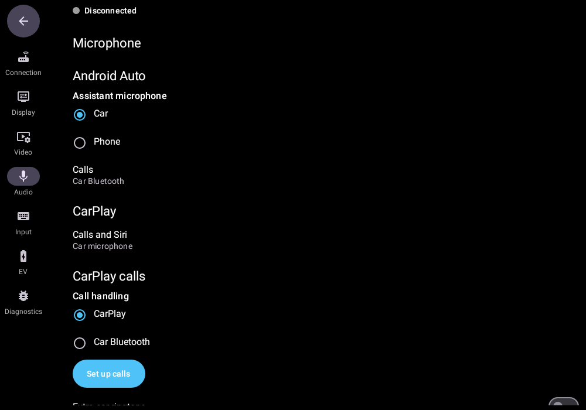

  
    
  

# OpenAutoLink — Android Auto & Apple CarPlay

> Bring Android Auto and Apple CarPlay to Android Automotive OS head units. 
> Phone projection on the car's existing screen. No SBC, dongle, or additional projection hardware.

OpenAutoLink runs on the vehicle's **Android Automotive OS (AAOS)** head unit. Android Automotive is the car's operating system; **Android Auto and Apple CarPlay are the phone-projection experiences** that OAL receives. OAL does not replace the car's operating system.

Android Auto and CarPlay share one app, with independent connection settings. **USB CarPlay is supported alongside wireless and USB Android Auto.** Wireless CarPlay remains available for development but is not working in the maintainer's vehicle.

[Releases](https://github.com/mossyhub/openautolink/releases/latest) · [Installation](#installation) · [Android Auto setup](#android-auto-setup) · [CarPlay setup](#carplay-setup) · [Compatibility](docs/compatibility.md) · [Troubleshooting](docs/troubleshooting.md) · [XDA discussion](https://xdaforums.com/t/open-source-openautolink-wireless-android-auto-bridge-for-aaos-gm-evs.4785192/)

> [!IMPORTANT]
> Install on a locked GM vehicle through your own Google Play Console app's **dedicated Android Automotive OS Internal Test**. APK sideloading is not supported on these head units.
>
> **Create your personal AAB at [oal.mossyg.com](https://oal.mossyg.com)** in a desktop Chrome or Edge browser—no source editing, desktop download or Android SDK setup.
>
> Save the required encrypted web identity backup for updates. CarPlay also needs your own compatible, authorized authentication pair; the builder does not supply it.
>
> [Create your AAB](docs/build-aab.md) · [Internal Test installation](docs/install-gm.md) · [CarPlay authentication](docs/carplay-private-mfi-assets.md)

## Choose your phone and connection

| Phone / mode | Connection | Companion needed? | Notes |
|---|---|---|---|
| Android Auto, wireless | Bluetooth + car Wi-Fi (WPP) | **Yes**, for GM wireless | Use WPP for Android Auto 17.4+ |
| Android Auto, USB | USB cable | **No** | GM shows [two USB access prompts on every connection](#gm-usb-prompts--android-auto-and-carplay), even with the choice saved |
| CarPlay, USB | USB cable; unpaired recommended | **No iPhone companion** | Car microphone for calls and button-initiated Siri; one-time Android call approval for native call presentation/controls. Car Bluetooth is a risk-bearing alternative: Bluetooth can cause repeated media pauses. Authentication identity and USB/VPN consent required; [two GM USB access prompts on every connection](#gm-usb-prompts--android-auto-and-carplay) |
| CarPlay, wireless | Bluetooth + Wi-Fi | **No iPhone companion** | Available for development; not working in the maintainer's vehicle |
| CarPlay, shared Wi-Fi | Existing Wi-Fi network | **No iPhone companion** | Advanced wireless network configuration; not a USB requirement |

Check the source revision and release notes for your installed build. USB hot-plug handoff is implemented, but current vehicle validation is still pending.

## What OAL provides

### Shared application

- One car app for Android Auto and CarPlay.
- Draggable Settings/Stats controls. Audio/call preferences save automatically; connection, video and display changes use **Save changes**. Wireless reconnects automatically when safe. For an actual USB connection, saving persists the next-session settings without stopping projection; unplug and reconnect physically to apply.
- **Settings → Audio → Both → Open OpenAutoLink in vehicle Audio** requests the car’s native media view for either protocol; unavailable platforms report that rather than claiming source selection.
- Configurable display layout, safe areas and video sizing for wide AAOS screens.
- Built-in diagnostics, optional log upload and network/vehicle inspection tools.
- Separate Android Auto and CarPlay settings; one phone projects at a time.
- Temporary USB hot-plug: when a phone arrives during active or connecting projection, choose **Switch** or **Stay here** without changing either protocol's saved connection mode.

### Android Auto

- **Wireless WPP and direct USB**, without additional projection hardware.
- **EV data in Google Maps**: vehicle battery, range, charge-port data and a configurable energy model. See [EV range estimates](docs/ev-range.md).
- **Instrument-cluster navigation and media metadata** on supported vehicles. Navigation-app support varies.
- **Phone calls**, microphone, steering-wheel controls and ignition reconnects.
- **H.264, H.265 and VP9 video**, with manual 1440p (2560×1440) and 4K (3840×2160) tiers and portrait equivalents, subject to phone/decoder support.
- **Automatic video sizing prefers 1440p** where supported; 4K can be selected manually.

### CarPlay

- No iPhone companion app or additional projection hardware.
- **USB projection**, with wireless connection retained separately for development.
- **USB CarPlay music, navigation and touch controls**, with unpaired USB recommended. **Car Bluetooth** remains available, but Bluetooth can cause repeated media pauses even with Media audio off.
- **Car microphone for calls and button-initiated Siri**, without diagnostic arming. Calls and Maps Siri have been tested in the maintainer’s car; restart/ignition reliability remains under validation.
- **Call handling → CarPlay** combines supported native incoming-call presentation and Answer/Reject/End after Android approval. Unpair the iPhone from the car and leave Bluetooth disconnected in this mode. CarPlay calls still support the car microphone, steering-wheel controls and driver display/cluster on supported vehicles; the cluster may show **Unknown** even when CarPlay shows a contact. **Extra car ringtone** defaults Off. Detected Bluetooth conflicts warn and withhold new OAL native calls, but OAL cannot guarantee automatic duplicate prevention across Bluetooth reconnects. See [calls and setup](docs/phone-calls.md).
- **Multi-touch gestures**, including map pinch-to-zoom.
- **Adjustable video quality, Fit to window and safe-control calibration** for wide or curved screens.
- **Music information and artwork on supported vehicle displays**. Cluster route guidance is still being refined.
- Night-mode and vehicle-data integration.

## Installation

### Car app on a locked GM vehicle

1. [Create your AAB on the website](docs/build-aab.md#create-your-aab) and save the required encrypted identity backup.
2. Follow the [Internal Test installation guide](docs/install-gm.md): register with Google, create a free app, select **dedicated Android Automotive OS → Internal testing**, upload, enroll the car's Google account, and select the **car** in Google's web install picker.

Check Google's **US$25 one-time registration fee and Android-device verification requirement for new personal accounts before paying**, especially if you only own an iPhone. A completed build does not prove Play acceptance or car eligibility.

For CarPlay, include your own [authorized authentication pair](docs/carplay-private-mfi-assets.md). For updates, restore your latest web backup, keep the **same application ID and upload key**, and upload a higher-version AAB to the same Internal Test. [Desktop builder documentation](docs/desktop-builder.md) remains available, but desktop downloads are not published yet.

The car itself needs internet-connected Wi-Fi or its data service; [an OnStar data plan is not required](#car-internet-no-onstar-data-plan-required).

The car APK on [GitHub Releases](https://github.com/mossyhub/openautolink/releases/latest) is for AAOS systems/emulators that permit APK installation. **It cannot be sideloaded onto a locked GM production head unit.**

### Car internet: no OnStar data plan required

**You do not need an OnStar data subscription to install or use OAL.** Without a vehicle data plan, connect **the car itself** to a Wi-Fi network with working internet, such as your home Wi-Fi, to download OAL through Google Play. A local car hotspot used for wireless Android Auto is not, by itself, an internet connection for the car.

**Keep your car's apps updated—not just OAL.** Like your phone, the car has a Play Store and apps that receive regular updates. Without an OnStar data plan, give **the car itself** internet access regularly:

- **At home:** save your home Wi-Fi in the car's network settings. When parked within range, leave the infotainment system on for a while so Google Play has time to download app updates.
- **Away from home:** connect the car to your phone's Wi-Fi hotspot **at least once a week, or more often**. I turn on my phone's hotspot on most drives to give the car frequent opportunities to stay up to date. Hotspot use draws on your phone's data allowance.

Enable automatic app updates in the car's Play Store and check for pending updates occasionally. Downloads depend on Play Store settings, connection quality and vehicle software; simply saving a Wi-Fi network does not guarantee updates while the car is off. This is routine care for all the car's Play Store apps, not an OAL-only requirement.

OAL's phone-projection connection does not require a paid OnStar data plan. Online navigation, music and other phone-app services still need their own internet connection, normally your phone's mobile data.

### Android phone

For wireless Android Auto, install `openautolink-companion-vX.Y.Z.apk` from the matching [release](https://github.com/mossyhub/openautolink/releases/latest), grant its requested permissions, and configure the paired car. USB Android Auto does not need the companion.

### iPhone

No OAL iPhone companion is required. Use a data-capable USB cable and your own [authorized authentication pair](docs/carplay-private-mfi-assets.md). Leave vehicle Bluetooth unpaired for recommended CarPlay calls, then complete **Settings → Audio → CarPlay calls → Set up calls** once. **Bluetooth can cause repeated media pauses**, including with Media audio off; the Car Bluetooth alternative is not the recommended setup. See the [USB steps](#usb-1) and [call guide](docs/phone-calls.md).

### Other AAOS systems

Install the car APK only if the platform permits it. Bluetooth, networking, audio and vehicle integration vary by platform. Reports from Polestar and other non-GM AAOS vehicles without built-in phone projection are welcome.

## Android Auto setup

### Current wireless path: WPP

For Android Auto 17.4 or newer:

1. Install matching current car and companion releases; enable the car's Wi-Fi access point.
2. In **OAL → Settings → Connection → Android Auto connection**, select **Wireless** (WPP).
3. To avoid typing the AP name/BSSID, select the paired car under companion **Auto-Start → Select Devices**, tap **Start WPP config listener** in the car's WPP settings, then use companion **Send WPP WiFi to Car → Scan & Send to Car** and tap the car hotspot. [Full walkthrough and troubleshooting](docs/wireless-wpp.md#send-ssidbssid-from-the-phone-instead-of-typing-them). **Only SSID/BSSID are sent**: enter the hotspot password in the car app, verify the interface serving that AP, then tap **Save changes**. Wireless reconnects automatically; if using USB, unplug and reconnect the phone. Manual SSID/BSSID entry is also available.
4. For the WPP migration, pair the phone to the car again after updating. Keep Bluetooth **Phone calls** enabled; **Media audio** may be disabled.
5. Remove any old **Car WiFi** entry in the companion so it does not compete with Android Auto for the radio.
6. Select the car under companion **Auto-Start → Select Devices**, then tap **Save changes** for automatic wireless reconnection.

Bluetooth pairing bootstraps wireless projection; Bluetooth **Phone calls** also carries cellular call audio, a separate role. The **Audio → Android Auto → Assistant microphone** choice does not change call routing.

**The companion is required for wireless Android Auto.** GM chooses which nearby paired phone connects first. See the [WPP guide](docs/wireless-wpp.md) for detailed setup and migration instructions.

### USB

Select **USB** under **Android Auto connection** for normal wired use, then connect a data-capable cable. No companion is needed. **Pair the Android phone with the car and keep Bluetooth Phone calls enabled for call audio**; USB projection does not replace that hands-free path. **Audio → Android Auto → Assistant microphone → Car / Phone** controls the assistant only and saves automatically for its next stream. [Accept both GM USB access prompts every time](#gm-usb-prompts--android-auto-and-carplay), even with the choice saved. You can also leave normal AA mode set to Wireless and use the temporary USB switch below.

### GM USB prompts — Android Auto and CarPlay

**Every USB connection shows two system access prompts, even if you check “Always open OpenAutoLink” or save the choice. Tap OK on both prompts each time.** This applies to both **USB Android Auto** and **USB CarPlay** on GM head units. It is a longstanding GM infotainment bug; **OAL cannot fix or bypass it**.

  
   <em>Example of one GM USB access prompt, shown for an iPhone with “Always open OpenAutoLink” already checked. Expect two prompts on every USB connection; USB Android Auto has the same limitation.</em>

These GM USB access prompts are separate from OAL's **Switch / Stay here** choice, the iPhone's **Trust** prompt and CarPlay's local VPN consent. This warning is for GM wired connections, not wireless projection.

### Temporary USB switch between phones

For example, keep **Android Auto connection → Wireless** and **CarPlay connection → USB**. Both phone protocols are available in the same app; using CarPlay does not disable wireless Android Auto or change its saved mode.

- Plug in an Android phone or iPhone while projection is connected or connecting. OAL offers **Switch / Stay here** before starting USB setup or stopping the current projection.
- **Stay here** (or dismissing the prompt) leaves the current projection alone. Replug the phone to offer it again.
- **Switch** attempts to stop the current receiver, then starts the attached phone over USB. Accept the applicable system permission/Trust prompts.
- The selection lasts for that cable connection only. Unplugging returns OAL to its saved normal connection policy; it does not rewrite either mode. Wireless reconnection still depends on the phone and vehicle.
- If stopping the old projection fails, use **Retry USB** or **Dismiss**. Dismiss hides the guidance; it does not bypass an incomplete shutdown.

This handoff is implemented for both phone protocols; successful end-to-end switching in the vehicle is still being validated.

### Android Auto video quality

If text or maps look soft, try **1440p** as the recommended manual quality setting: in **OAL → Settings → Video → Android Auto**, turn **Auto (Recommended)** off so it reads **Manual**, select **Video Codec → H.265 / HEVC**, then **AA Resolution → 1440p (2560×1440)** and tap **Save changes**, then reconnect your phone (wireless reconnects automatically; for USB, unplug and reconnect). Keep **GAL / PDK protocol version → 6.0** for the verified modern HEVC path.

**4K (3840×2160)** is an optional higher-detail setting if your phone and head-unit decoder support it. It costs more bandwidth and processing; return to 1440p if it stutters or fails to connect. Auto does not guarantee a particular negotiated resolution, and a blurry image alone does not prove the stream is 1080p. These codec controls apply to Android Auto, not CarPlay.

## CarPlay setup

Keep the vehicle parked while configuring. Disconnect the iPhone from any other OAL receiver before connecting it to the car.

### Common prerequisites

1. Install a current OAL build with a valid accessory authentication identity. Public GitHub APKs and source builds require your own compatible files. See the [authentication/build policy](docs/carplay-private-mfi-assets.md).
2. Use **USB** under **OAL → Settings → Connection → CarPlay → CarPlay connection** for wired projection. Wireless remains a development option; CarPlay and Android Auto connection modes are independent.
3. Tap **Save changes**, then reconnect your phone. Wireless reconnects automatically; for USB, unplug and reconnect. Keep file logging enabled for testing and upload results, including failed attempts.

If you previously turned off iPhone projection, OAL retains that choice. Only in that case, turn **Enable iPhone projection** back on in the same settings page and save. There is no separate enablement step for normal setup.

### USB

1. Select **CarPlay connection → USB** in OAL and tap **Save changes**. If already plugged in, unplug the iPhone before the next step.
2. Connect the iPhone to a data-capable head-unit USB port with a data-capable cable. If another projection is active, choose **Switch** to attempt temporary USB takeover.
3. [Tap **OK** on both GM USB access prompts every time](#gm-usb-prompts--android-auto-and-carplay), even if you saved the choice. Accept OAL’s separate local VPN consent when requested. If the iPhone asks to trust the connection, unlock it and approve **Trust** on the iPhone itself.
4. **Unpair the iPhone from the car and leave Bluetooth disconnected** for the recommended USB setup, and keep **OpenAutoLink selected in vehicle Audio**. USB does not need car Wi-Fi fields or Bluetooth pairing.
5. In **OAL → Settings → Audio → CarPlay calls**, leave **Call handling → CarPlay** and **Extra car ringtone → Off**.
6. Tap **Set up calls**, allow the requested phone permission, turn on **OpenAutoLink** in Android’s Calling accounts page, then return to OAL. **Ready** reflects actual approval and call availability; no Inspect, Arm, Apply or Save step is needed. Android approval does not grant cellular service or prove every vehicle supports native controls.
7. Test a call and button-initiated Siri while parked. “Hey Siri” wake detection is a separate iPhone path. OAL needs microphone permission for cabin capture; if input was unavailable when the session was created, grant it and explicitly reconnect while not in a call.

> [!WARNING]
> **Bluetooth can cause repeated media pauses, even with Media audio off.** Audio settings now mark **CarPlay** Recommended and show **Car Bluetooth** with a red warning. For normal USB CarPlay, unpair the iPhone from the car and leave Bluetooth disconnected. This warning is not a fix for the Bluetooth pause loop.

**Risk-bearing alternative — Car Bluetooth calls:** if you deliberately need native Bluetooth calls, select **Call handling → Car Bluetooth** in Audio, pair the iPhone and keep **Phone calls ON / Media audio OFF**. In **Connection → CarPlay → Android Bluetooth settings**, disconnect/reconnect after changing profiles, then return to OAL with OAL selected in vehicle Audio. Media OFF is not a reliable pause-loop workaround, and GM may restore Media after a wake. OAL changes neither Bluetooth profiles nor the iPhone audio route automatically. OAL calling-account approval is not required for this alternative.

Already approved an older OAL account? Its identity is retained; opening Audio or repeating setup is not required merely because projection reconnects. A handler change during an OAL call is saved for the next call, without hanging up the current one. Android Auto remains separate: keep its phone paired with **Phone calls** enabled.

The VPN permission is used locally for the USB connection—not an Internet VPN service. Another active VPN can conflict. USB access and permission support vary by head unit.

OAL can remember more than one iPhone’s CarPlay trust. Connect the iPhone you want to use and approve its own permission/Trust prompts; you do not need to erase OAL’s settings or remove the previous iPhone. Only one phone projects at a time. WPP phone selection remains managed by the vehicle’s Bluetooth system, not an OAL preferred-phone list.

### Wireless CarPlay

Wireless CarPlay is still in development and is not working in the maintainer's vehicle. Use USB for now. Advanced wireless configuration is covered in the [network guide](docs/carplay-network-contract.md).

### CarPlay UI restrictions (optional)

While parked, open **Settings → Connection → Normal connections → CarPlay → CarPlay UI restrictions**.
**Vehicle-based UI restrictions** is saved independently of Android Auto and defaults **OFF**.
Enable it to declare keyboard/list restrictions and allow the main-screen UI only with fresh,
valid vehicle Park information. Missing/stale gear remains restricted. This policy is not yet
validated on every vehicle, so ordinary builds do not enable it automatically.

**Always in Park** is a separate CarPlay override, also default **OFF**, available when restriction
control is enabled. It releases main-screen keyboard/list restrictions even without Park information;
use it only while safely parked. It does not change actual gear, Android Auto settings, secondary
displays or video permissions. Tap **Save changes**, then reconnect your phone to apply either choice to a fresh session. Wireless reconnects automatically; for USB, unplug and reconnect.
No special build flag is needed. See the [policy and validation limits](docs/carplay-driving-restriction-policy.md).

### Video and display controls

- New CarPlay settings default to **Automatic** resolution targeting a decoder-qualified **1440p-class** image and **Codec → Automatic (H.264 + qualified HEVC)**, with qualified lower-detail fallbacks. Saved video choices are retained. If you choose manual settings, open **OAL → Settings → Video → CarPlay**, select **Manual** under **Resolution / detail**, then choose **1440p** (recommended) or try **4K** if supported. **Fit to window (standard detail tiers)** keeps the selected detail tier at the available window aspect without stretching; custom resolutions retain their chosen aspect ratio. Tap **Save changes**, then reconnect your phone. Wireless reconnects automatically; for USB, unplug and reconnect.
- **Codec → Automatic (H.264 + qualified HEVC)** is the default for new CarPlay settings. If you choose manual video settings, we recommend this codec setting with **1440p** for the best balance of detail and performance. It offers HEVC only when the exact size/rate qualifies and retains H.264; it does **not** force the iPhone to use HEVC or change your resolution. Existing saved H.264 choices are preserved, so users with saved H.264 settings should select Automatic explicitly. If connection fails, select **H.264**, tap **Save changes**, then reconnect your phone (for USB, unplug and reconnect; wireless reconnects automatically). 4K adds bandwidth and processing demand; return to 1440p if it stutters. Blurry video alone does not establish the negotiated resolution.
- **For CarPlay on curved screens, we recommend Display → System UI Visible.** OAL starts in fullscreen mode by default, but CarPlay controls can be clipped by the physical screen curves in fullscreen.
- In **Display → Calibrate safe controls**, adjust the safe rectangle to inset CarPlay controls as far from the edges as you prefer. This is manual adjustment, not automatic curve detection; without suitable insets, fullscreen can cut off parts of the UI. Confirm the calibration, tap **Save changes**, then reconnect your phone (for USB, unplug and reconnect; wireless reconnects automatically).
- If you prefer fullscreen, **swipe down from the top edge of the screen to reveal the GM navigation bar** when you need the vehicle's system controls. This does not replace safe-control calibration.
- Available resolutions and frame rates depend on the phone and head unit. A frame-rate setting is a limit, not a guarantee. Safe-area calibration and system-bars-visible layouts still need broader vehicle testing.

### Authentication and source builds

Public GitHub APKs and ordinary source builds omit the CarPlay authentication files and require your own compatible, authorized pair. OAL is **not an Apple-certified CarPlay product**. Bundled files are extractable; never publish authentication files or signing keys. See [CarPlay authentication](docs/carplay-private-mfi-assets.md) for the exact file formats and authorization limits.

## Audio and call settings

**Settings → Audio** keeps Android Auto, CarPlay and shared actions visibly separate, whether connected or not. Ordinary audio/call choices save automatically; this page has no global **Save changes** button. Android Auto assistant source applies to its next microphone stream; its volume offsets apply at the next Android Auto connection. Connection/video/display drafts stay separate. See the [complete call guide and app/GM illustrations](docs/phone-calls.md).

*Prior app illustration rendered by Compose/NativeGraphics; setup state is a test fixture, not an actual Android approval. These images predate the new red Bluetooth-pause warning and Recommended label and have not been refreshed for this change. Follow the current text above. The call guide separately includes a sanitized real GM Calling accounts photograph.*

### Play phone media from vehicle Audio

1. Connect Android Auto or CarPlay using the setup above. OpenAutoLink is the vehicle Audio source for either protocol; it is not a separate Bluetooth media connection.
2. Open the vehicle’s native **Audio** app and select **OpenAutoLink**. Or use **OAL → Settings → Audio → Both → Open OpenAutoLink in vehicle Audio**. That shortcut requests the native view; if unavailable or denied, open Audio manually. Confirm the selected source in the vehicle UI—the shortcut does not prove selection.
3. Where the vehicle shows a browse view, open **Phone audio → Connected phone** to request playback from the current phone. The subtitle identifies **Android Auto** or **CarPlay**. This is a playback entry, not a catalog of phone apps, playlists or tracks; choose those in Android Auto or CarPlay.
4. Use the vehicle’s available Play/Pause and track controls, or the projected music app. Controls and title/artwork depend on the phone app and vehicle. Some GM hosts request Play as soon as the source is selected, so selection may resume audio without a separate Play tap.

**No phone connected?** The source can still appear with **Phone audio — Connect a phone**, but there is no playable **Connected phone** entry. Opening Audio does not connect a phone or start projection. Connect normally, then reopen the source if the vehicle has not refreshed it. During connection or shutdown, the subtitle may read **Connecting** or **Unavailable**.

**Returning from FM or another source?** Select OpenAutoLink again and use the normal vehicle **Play** control if needed. The current CarPlay candidate keeps the native playback state paused after native Pause/Stop or permanent media-focus loss, allowing a compatible vehicle host to send ordinary Play on source return instead of mistaking phone PLAYING metadata for audible OAL output. There is **no separate Resume audio button**. Automatic source-return recovery still needs vehicle confirmation for both music and navigation; it depends on the host sending Play and granting audio focus. Phone-only Play is not a guaranteed substitute. See [source-return recovery and its limits](docs/carplay-source-return-recovery.md).

**No sound?** Confirm OpenAutoLink is selected, check the vehicle’s media volume and try native **Play** once. A visible source, title or accepted Play request alone does not prove audible playback. For USB CarPlay, unpair vehicle Bluetooth if repeated pauses occur; **Media audio OFF does not eliminate that risk**. See the [call guide](docs/phone-calls.md#alternative--car-bluetooth-calls). Do not enable diagnostic recovery or microphone overrides as a normal setup step.

### What Save changes does

Connection, Video and Display changes are saved together before any reconnect action. On an **actual USB connection**, saving leaves the current projection running and shows **Saved. Unplug and reconnect USB to apply.** Physically unplug/reconnect to negotiate the saved changes; saving alone does not restart or prove a replacement session. Temporary USB connections follow the same rule even if the saved normal mode is Wireless. Wireless reconnects automatically when safe; during a call, OAL instead shows **Saved. Reconnect after the call to apply.** Audio/call choices remain independently autosaved.

## Adjust text, icons and UI size

Configure these while parked in **OAL → Settings → Display**. Android Auto and CarPlay have separate scaling controls; changing one does not change the other. Tap **Save changes** after adjusting them, then reconnect your phone to apply the settings to the next projection session. Wireless reconnects automatically; for USB, unplug and reconnect.

### Android Auto — DPI scaling

Under **Android Auto → AA Display Density (DPI)**:

- Leave **Auto DPI** on for sizing based on the available projection area and the head unit's display density. It accounts for fullscreen versus system-UI-visible layouts and the negotiated video size.
- For manual control, turn **Auto DPI** off. If **Layout Width Target** is shown, select **Off** too so it does not override the DPI slider.
- Adjust **DPI**: **lower DPI** gives smaller text/icons and more content; **higher DPI** gives larger text/icons and less content at the same video resolution. DPI can also change Android Auto's card and panel layout.
- With automatic video negotiation, **Layout Width Target** offers **Compact**, **Normal** and **Wide** presets to keep a consistent logical layout width across resolution tiers. This is an alternative to choosing a fixed manual DPI.

### CarPlay — UI scaling

Under **CarPlay → CarPlay UI scale**:

- Leave **Auto sizing** on to estimate physical size from the next session's projection area and available display measurements. When measurements are unavailable or unreliable, Auto uses the saved reference calibration and viewport fit instead; this fallback is not a measured panel size.
- Turn **Auto sizing** off to unlock **Manual UI size**. Select **Show exact calibration** to enter an integer in **UI calibration (mm)**; exact entry starts collapsed and shares the same pending setting as the slider.
- Move the slider **left toward Smaller UI** to request smaller text/icons and more content, or **right toward Larger UI** to request larger text/icons and less content. The iPhone chooses the final layout and may apply steps or limits; check actual control size while parked.
- **Manual calibration** spans **100–400 mm**. A wider advertised physical width requests smaller UI; a smaller width requests larger UI. This is CarPlay calibration metadata, **not Android Auto DPI** or video resolution. The extended range introduced in 0.1.551 was reverted after black-screen reports; saved values outside this range return to the 200 mm baseline. Valid saved calibrations are preserved.

- **Last frozen offer** shows **Offered locally** or **Ended**, its basis and offered millimeters, separately from the **Next session** draft. This is local receiver evidence, not proof of phone-visible size or usable video.
- Under **CarPlay status bar**, choose **Automatic**, **Bottom** or **Driver side** for the next connection. Placement does not change text/icon density.
- Use **Save changes**. Wireless reconnects automatically when safe; USB requires unplugging and reconnecting.

The retained 100–400 mm range is product compatibility policy, not an Apple protocol maximum. No expanded range or new numeric default is introduced.

**UI scale is not video resolution.** Use **Video** settings for image detail and **Fit to window** for CarPlay's standard-tier canvas fit. Use **Display → Calibrate safe controls** to move CarPlay controls away from curved screen edges; changing UI size does not replace safe-area calibration. Neither protocol's scaling control changes the vehicle's native apps or OAL's own settings UI.

## Keep incoming and active calls in Android Auto or CarPlay on GM

For recommended **unpaired USB CarPlay**, select **Audio → CarPlay calls → Call handling → CarPlay** and complete **Set up calls** once. Normal cabin-microphone calls and button-initiated Siri require no diagnostic arming. CarPlay mode retains supported native call/cluster controls, although the cluster may display **Unknown** while the main CarPlay UI shows the contact. **Car Bluetooth** is a risk-bearing alternative: repeated media pauses can occur even with **Media audio OFF**; the selector does not itself reroute iPhone audio. See the [complete call guide](docs/phone-calls.md).

For **Android Auto**, or when managing native GM call-screen behavior, use these vehicle settings to stop GM's native Phone app from covering the projected incoming-call and in-call controls on the center display:

1. Open the vehicle's native **Phone** app.
2. Tap the **Settings** gear.
3. Turn **Active Call** **OFF** (“Show active call view when answering call”).
4. Turn **Privacy** **ON** (“Only show call alerts in cluster”).

On the tested GM setup, these preferences kept alerts in the cluster without the native active-call screen covering projection; verify the result on your vehicle.

These are **Phone-app display settings**, not Bluetooth profile settings. For **Android Auto**, leave the paired phone's Bluetooth **Phone calls** profile **enabled**: the vehicle's hands-free system carries microphone and speaker audio, and disabling it can also break wireless WPP startup. See [Phone calls](docs/phone-calls.md) for Android Auto audio routing, verification and troubleshooting.

## Vehicle compatibility

Android Auto community reports are linked below. Compatibility varies with vehicle software, phone and connection mode.

| Vehicle | AAOS | Android Auto reports |
|---|---:|---|
| 2024 Chevrolet Blazer EV | 12L | Maintainer daily driver |
| 2025–2026 Chevrolet Equinox EV | 14 reported | [Successful owner report](https://xdaforums.com/t/open-source-openautolink-wireless-android-auto-bridge-for-aaos-gm-evs.4785192/post-90708465), alongside earlier build/setup issue reports |
| 2027 Chevrolet Bolt | — | [Independent demonstration](https://www.youtube.com/watch?v=xEYOxJroplQ) and [owner report](https://www.chevybolt.org/threads/openautolink-the-cheapest-way-to-get-andriod-auto-on-the-27-bolt.63027/) |
| Other GM AAOS EVs | Varies | Additional owner reports welcome |
| Non-GM AAOS | Varies | Additional owner reports welcome; platform integration varies |

See [compatibility notes](docs/compatibility.md) for vehicle-specific information.

## Demonstrations

### Apple CarPlay

CarPlay Dashboard combines navigation and playback controls on the Blazer EV's wide display.

  
   <em>Fullscreen CarPlay, with the vehicle's top system bar hidden.</em>

  
   <em>CarPlay with the vehicle's top system bar visible. Climate controls remain accessible below in both views.</em>

### Android Auto

  
   <em>Android Auto on the Blazer EV.</em>

  
   <em>Real vehicle battery data forwarded into Android Auto's Google Maps.</em>

The walkthrough's original wireless setup predates Android Auto 17.4. Use the WPP guide, not the video's historical connection instructions.

## Microphone permission and privacy

**Why does OAL ask to “record audio”?** Android uses that permission wording for any microphone access—even live passthrough. OAL needs it to pass the car's microphone to your phone through CarPlay or Android Auto for supported voice features.

**OAL does not save microphone recordings or upload microphone audio to the developer or any external server.** Audio is passed live to your connected phone, not kept as a recording. Your phone handles voice services under its own privacy settings.

Optional diagnostic-log uploads and EV-profile downloads are separate; see the [privacy policy](docs/privacy-policy.md).

## Diagnostics and useful test reports

CarPlay sessions now use foreground protection for connected-device/media work, with microphone eligibility when Android permits it; this helps protect background operation but does not guarantee ignition/restart recovery. Normal CarPlay projection also supplies bounded passive numeric capture/playback measurements for manual log upload, without saving audio or automatically uploading. These are observations, not a microphone repair. For silent car microphone reports, the opt-in **Diagnostics → Microphone** tool compares local capture channels, sample rates and an available named input while parked. It retains up to 12 bounded numeric comparisons for manual log upload—never microphone audio. It is a diagnostic, not a call-audio fix or phone-microphone selector. See [parked microphone test instructions](docs/microphone-diagnostic.md).

**Diagnostics → Media integration** offers read-only media comparisons and an explicitly chosen local **Save media-host APK ZIP** export. The latter saves only the fixed media host’s public APK files, not private app data; it is unencrypted and may contain vendor IP, grants no redistribution rights, and is never included in log uploads. Bounded media-history receipts can remain available for authorized manual log ZIPs even with File Logging Off.

Enable OAL file logging **before** reproducing a problem, then use the configured log-upload control. Each app uploads **only its own logs**: the car upload does not collect companion or iPhone logs. Consecutive uploads can contain overlapping sessions.

Include:

- Vehicle/model year, AAOS version and exact OAL build.
- Phone model, Android Auto or iOS version, and the chosen protocol/transport.
- Approximate attempt time, configuration changes and what appeared on both screens.
- Whether Wi-Fi joined, projection rendered, touch worked and audio was audible—these are separate outcomes.
- For cluster issues, the navigation app and what appeared on the cluster/media display.

Never post passwords, accessory credentials, upload invitation tokens or account emails. Logs/screenshots may contain private identifiers, location or media; use the configured private upload route rather than a public raw dump. See [Troubleshooting](docs/troubleshooting.md) and [Privacy policy](docs/privacy-policy.md).

## Documentation and development

User guides:

- [Create your AAB on the website](docs/build-aab.md) and [Internal Test installation on GM](docs/install-gm.md)
- [Desktop AAB builder preview](docs/desktop-builder.md) (downloads not yet available)
- [Wireless Android Auto](docs/wireless-wpp.md)
- [Compatibility](docs/compatibility.md), [EV range estimates](docs/ev-range.md) and [phone calls](docs/phone-calls.md)
- [Troubleshooting](docs/troubleshooting.md), [CarPlay source-return recovery](docs/carplay-source-return-recovery.md) and [privacy policy](docs/privacy-policy.md)

Developer guides:

- [Architecture](docs/architecture.md)
- [Advanced Docker build fallback](docs/manual-build.md)
- [CarPlay authentication/build policy](docs/carplay-private-mfi-assets.md)
- [Connection modes and USB switching](docs/usb-hotplug-independent-protocol-modes.md)
- [CarPlay networking](docs/carplay-network-contract.md), [display sizing](docs/carplay-window-safe-area-contract.md) and [cluster integration](docs/carplay-cluster-metadata-handoff.md)

## Contributing and support

Use [GitHub issues](https://github.com/mossyhub/openautolink/issues) for reproducible defects and [XDA](https://xdaforums.com/t/open-source-openautolink-wireless-android-auto-bridge-for-aaos-gm-evs.4785192/) for setup and owner reports. Include exact builds, reproduction steps and logs.

Reports from Polestar and other non-GM AAOS vehicles are especially welcome, from both Android and iPhone owners. Follow the [build and installation guidance](#car-app-on-a-locked-gm-vehicle). Public GitHub builds omit private CarPlay authentication assets; see the build policy before choosing that installation route.

## Acknowledgments

- Adam Harlow — native GM Audio discovery/browsing and background-media work that informed this integration.
- [opencardev/aasdk](https://github.com/opencardev/aasdk) — Android Auto protocol library; the OAL fork adds navigation and EV energy-model extensions.
- [shihabal3amri/DiPlay](https://github.com/shihabal3amri/DiPlay) — CarPlay receiver source/reference adapted for OAL; upstream credits shilapi/xcertplay. See retained source notices and the private authentication policy.
- [metheos/carlink_native](https://github.com/metheos/carlink_native), [lvalen91/Carlink](https://github.com/lvalen91/Carlink), and the [XDA Carlink thread](https://xdaforums.com/t/carlink.4774308/) — proof-of-concept inspiration and technical collaboration.
- [opencardev/openauto](https://github.com/opencardev/openauto) — head-unit architecture reference.
- [nisargjhaveri/WirelessAndroidAutoDongle](https://github.com/nisargjhaveri/WirelessAndroidAutoDongle) — Bluetooth/Wi-Fi bootstrap reference.
- [andreknieriem/open-headunit](https://github.com/andreknieriem/open-headunit) — receiver/protocol reference.

## License

OpenAutoLink is licensed under the [GNU General Public License v3.0](LICENSE). Retain the attribution and license notices for included/adapted components. Source availability does not confer rights to redistribute private accessory authentication assets.
