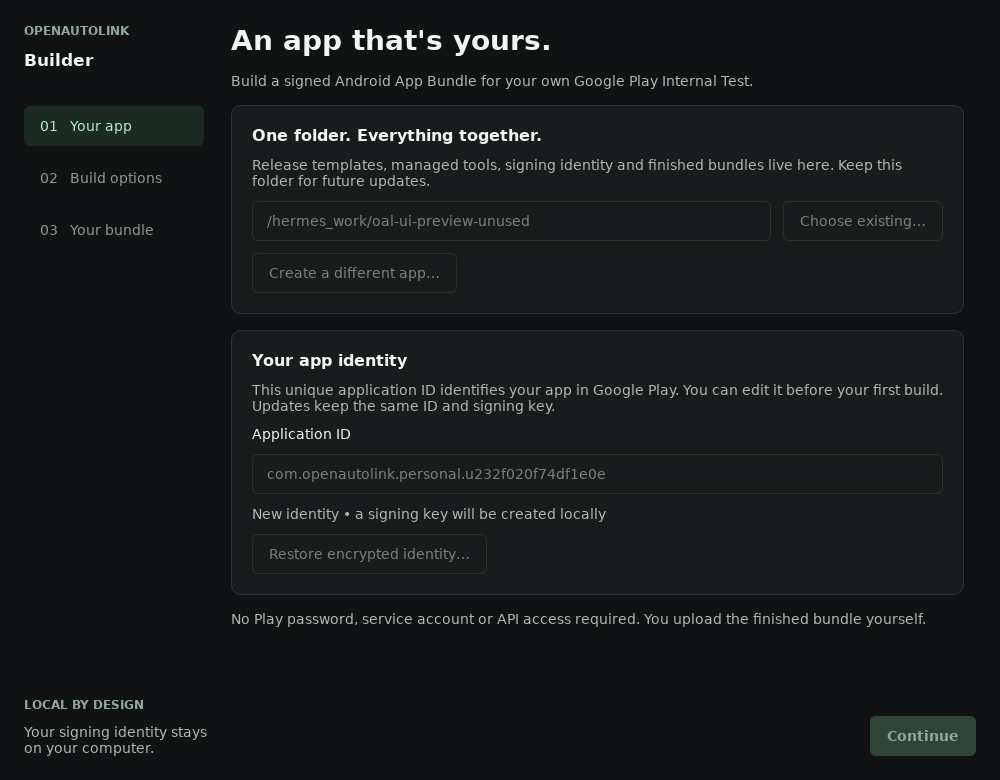
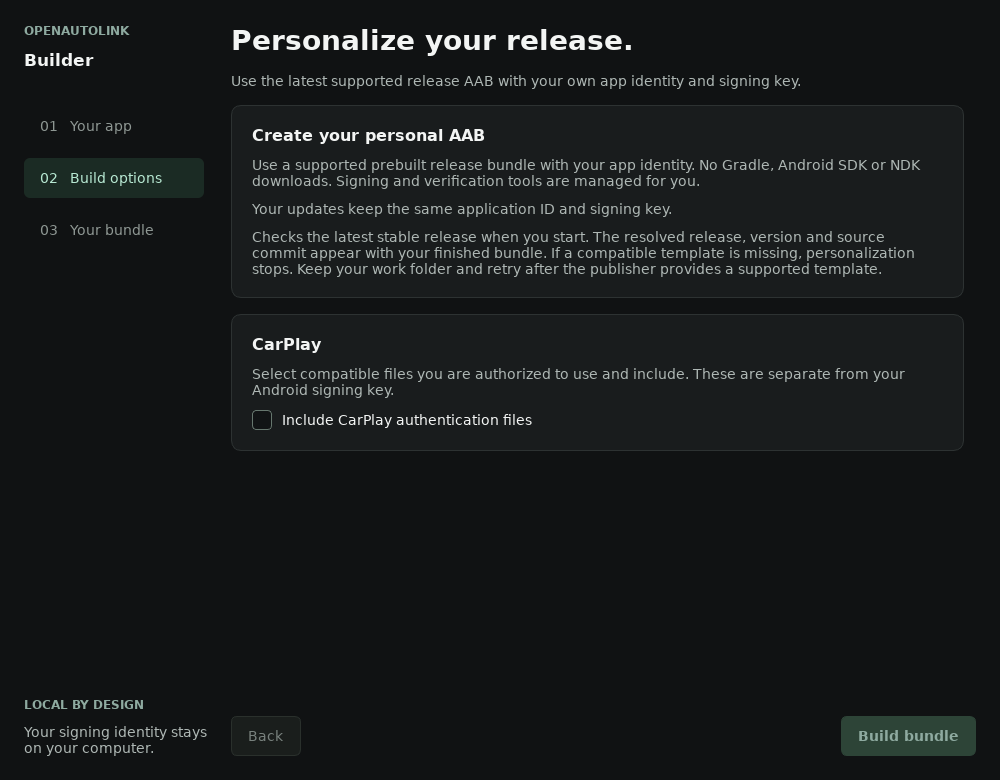

# Create your personal OAL car app

**Personalize the latest supported release AAB** to create a signed bundle for your own Google Play Console app—without compiling OpenAutoLink. The tool applies your app identity, optional user-supplied CarPlay files, and your upload signature.

## Create your AAB

The desktop tool personalizes precompiled AABs only. It does not compile OpenAutoLink or install the Android SDK/NDK.

This tool is for people creating their **own** Play app, not the maintainer's existing app. The maintainer keeps the established release signing and Play publishing process; public releases additionally provide a credential-free AAB template and its verification metadata.

Your saved personal application ID, upload key, version history and encrypted backup carry forward between updates. Continue with the [dedicated AAOS Internal Test installation guide](install-gm.md) after creating your AAB.

### Easy path: personalize a release AAB

The planned flow is to verify a supported, credential-free release AAB, apply your unique application ID and package-specific manifest values, optionally include your authorized CarPlay pair, and sign the result with your own upload key. Compiled app code is reused rather than rebuilt, avoiding Gradle and Android SDK/NDK setup for this path. Packaging/signing tools are still needed and will be managed by the tool.

Use a designated personalization-ready **AAB**, not the release APK renamed to `.aab`. The published template is **unsigned** and contains no private CarPlay authentication files. The tool checks its tag, source commit, format, size and SHA-256 against the release metadata hosted by the official GitHub repository. This trusts that repository and HTTPS; it is not verification against the maintainer's Android signing certificate. Your finished personalized AAB is signed with your own upload key. The maintainer's private key is neither needed nor shared. Google Play separately manages the app-signing key for your own app.

**This is not an available download yet.** Local bundle transformation, signing and generated-APK checks pass on the retained test bundle. Latest-release template publication, native personalization qualification and separate Play/car verification remain outstanding. The screenshots below show the AAB-personalization wizard, not proof of release readiness.

The steps below follow the AAB-personalization workflow.

> [!IMPORTANT]
> **Desktop packaging preview:** downloadable desktop release files are not published yet. The Windows EXE, Linux single executable, and macOS app in a DMG are packaging targets, not currently available downloads. Do not download the car or companion APK expecting it to be the desktop builder. The steps below describe the desktop workflow; the existing [advanced Docker fallback](manual-build.md) is separate.

The result is for **Internal Test on the dedicated Android Automotive OS track**. It is the car app, not an Android phone app. After building, follow [Install through your own Internal Test](install-gm.md).

## Before you start

- Use a computer and a private local folder you trust, with internet access and room for managed tools, templates, caches and outputs. The tool manages Java/bundle tools, not the Android SDK/NDK. Do not choose a temporary or shared folder.
- Keep the managed folder between builds. It holds your permanent application identity and upload-signing key as well as replaceable build tools.
- Review the [Play account registration requirements](install-gm.md#1-register-your-play-console-developer-account), including the one-time registration fee and Android-device verification for new personal accounts. **iPhone owners should check that prerequisite before paying.**
- For CarPlay, have your own compatible authentication pair ready, with authorization to use and include it. Android Auto does not require these files. Read [CarPlay authentication files](carplay-private-mfi-assets.md).

## 1. Open the desktop builder

Once a desktop release is actually published, choose the file for your operating system:

| Computer | Packaging target | How it opens |
|---|---|---|
| Windows x86_64 | `OpenAutoLink-Builder.exe` | Open the executable |
| Linux x86_64 | `OpenAutoLink-Builder` | Allow execution in a supporting file manager, then open it |
| Mac Intel or Apple Silicon | `OpenAutoLink-Builder.dmg` | Copy the single app to Applications and open it; architecture selection is automatic |

You do not install Python or PySide separately. Windows packages are not Authenticode-signed; Mac packages are not Developer ID-signed or notarized. Do not bypass warnings for an unverified download or globally disable OS security protections.

Linux targets Ubuntu 22.04 graphical desktops with X11/XWayland and normal graphics libraries. Browser downloads can lose the executable permission, and some file managers do not launch binaries by double-click. A one-time **Properties → Permissions → Allow executing** step may be necessary. See [platform requirements and qualification limits](../desktop-builder/packaging/README.md). Packaging and startup tests are not proof of a successful Android build on every platform.

## 2. Choose your managed folder and application identity

*Actual Linux read-only wizard capture; paths and generated IDs differ on your computer. Controls are disabled only for screenshot testing.*

1. Select a private, permanent **managed folder**. The builder keeps its own tools there rather than changing your system Java installation or global PATH.
2. For a new app, keep the generated unique **application ID** unless you have a specific reason to change it. It is the package identity Google Play uses, not the display name. Do not use the upstream `com.openautolink.app`.
3. If you are continuing an app made by this builder on another computer, **restore its encrypted identity backup first**. Do not create a fresh identity and try to use it as an update.
4. Continue to the optional CarPlay files. No source-build mode or Android SDK consent is needed.

The builder remembers your chosen folder on this computer. If that folder or its saved identity disappears, it blocks building and asks you to locate or restore it; it does not silently create a replacement. Only the folder path and application ID are stored in the operating system's per-user preferences. Keys, downloads, and build state stay in the managed folder. Use **Create another app** only when you intentionally want a different Play app.

The builder generates an Android **upload-signing key** for a new identity. No source-package renaming or manual keystore commands are needed. Keep that same application ID and key for later builds.

Already have a Play app from another build system? Stop before making a new key: its existing package ID, accepted upload key, and highest uploaded version code must be preserved. A new desktop identity is not an automatic migration. The [advanced fallback](manual-build.md#existing-apps) describes existing-keystore input.

## 3. Select optional CarPlay authentication files

*Actual Linux read-only wizard capture. Disabled controls are a screenshot-test safeguard, not a requirement in normal use.*

For CarPlay, select both files using the wizard's file pickers:

- `identity.pk8` — a matching P-256 private key in PKCS#8 format.
- `certificate.p7b` — its single X.509 certificate in supported DER or PKCS#7 form.

Use only a compatible pair you are authorized to include. Each file must be nonempty and at most 16 KiB. Choose both or leave both empty; a partial pair is not usable. Renaming unrelated files does not make them valid.

These are **not** your Android upload-signing key. The builder does not generate or supply a CarPlay authentication identity. A build without them can be used for Android Auto but does not, by itself, enable CarPlay. Bundled files can be extracted from the distributed app; encrypted identity backups do not hide them inside an AAB. See the [authorization and privacy limits](carplay-private-mfi-assets.md).

## 4. Build the signed AAB

Start the build and keep the application open while it works. The desktop workflow:

1. Resolves the latest stable GitHub release to its exact source revision and checks compatibility.
2. Verifies and downloads that release’s template plus managed signing tools.
3. Changes only the reviewed package-specific bundle fields and optional assets, preserving compiled app code.
4. Signs the AAB with your saved upload key.
5. Checks the result and shows the artifact path, package ID, source revision, and version.

Use the **successful build result**, not a partial file left after an error. Select the resulting `.aab` when Play Console asks for an app bundle. Do not upload a desktop executable, companion APK, backup archive, checksum, or metadata file instead.

Before uploading, record the displayed application ID and version code and locate the AAB on disk. Keep the accompanying build metadata so you can identify the source and signing identity later. A local build is not a Play upload, a rollout, or proof that a particular car is eligible.

## 5. Make an encrypted identity backup

Use the desktop backup action **before your first upload**:

1. Choose a backup location outside the managed folder, preferably on a separate private drive.
2. Set a strong backup password and keep it in a password manager separately from the archive.
3. Keep the encrypted archive and the password safe. Anyone with both can recover the upload-signing identity.
4. Make a fresh backup after successful updates so the saved version state stays current.

To move computers, choose a new managed folder in the builder and use **Restore** with that archive and password before building. Check that the restored application ID matches your existing Play app. Do not overwrite your only working identity while testing a restore. Keep the original folder until the restored copy has been checked.

An identity backup is not a backup of every downloaded tool, build cache, or external CarPlay file. Keep authorized CarPlay originals separately and reselect them when needed. Losing the signing identity can interrupt updates; creating a random replacement key is not a repair for an existing Play app.

## 6. Install through Internal Test

Continue with the [complete Play Console and car installation guide](install-gm.md). It covers registration, a free app, the dedicated **Android Automotive OS** selector, uploading the AAB, tester enrollment, and choosing the **car** in Google Play's web install picker.

The desktop builder does not sign in to Google, create your developer account, accept declarations for you, upload to Play, or install onto the car. Those steps stay under your control.

## Later updates

1. Open the builder with the **same managed folder**, or restore your latest identity backup first.
2. Check for the latest stable GitHub release, then personalize its supported AAB template using the saved application ID and upload key. Reselect your authorized CarPlay pair if required.
3. Check that the new version code is higher than every code already uploaded to this Play app. If another computer or build system uploaded a newer code, reconcile that state before uploading; an old backup cannot know about later uploads.
4. Back up the updated identity state.
5. Upload the new `.aab` to the **same app's dedicated Android Automotive OS Internal Test**, then roll it out.
6. Give the car internet access and confirm the update in its Play Store.

The tool checks the **latest stable GitHub release** at the start of each operation, then uses that resolved revision consistently. It requires a compatible template and verified metadata for that release. If the latest release is unsupported or lacks its template, the tool reports that rather than silently selecting an older release. There is no arbitrary source-ref field in the beginner workflow.

Earlier source-build qualification used **v0.1.526** at `580a68d772afc97e444019504178f1678731feb6`; that historical result does not qualify a newer release or the new mode integration. Installing a newer desktop tool does not update the car by itself: create and upload its AAB using the same identity.

## Developer source builds

The previous source-build implementation is preserved for development, but is not offered by this desktop tool. The maintainer’s existing release/signing and Play publishing workflow is unchanged. [Manual source-build notes](manual-build.md) remain separate from this user guide.

## If something goes wrong

| Problem | What to check |
|---|---|
| A download or build fails | Keep the managed folder, note the failing step, and retry. Do not erase the identity to fix a network problem. |
| The folder is already in use | Let the other build finish or cancel it; do not run two builders against the same folder. |
| Only one CarPlay file is selected | Select its matching partner or clear both to build without bundled CarPlay authentication. |
| Package ID or signing key differs from the existing Play app | Restore the correct identity; do not upload a new identity as an update. |
| Play rejects a reused version code | Compare with the highest code already uploaded, not just the installed version. |
| The AAB builds but the car cannot install it | Follow the separate [membership, rollout, eligibility, and propagation checks](install-gm.md#troubleshooting). |

Never attach upload keys, backup passwords, or CarPlay authentication files to an issue. Review screenshots and logs for personal identifiers before sharing.
