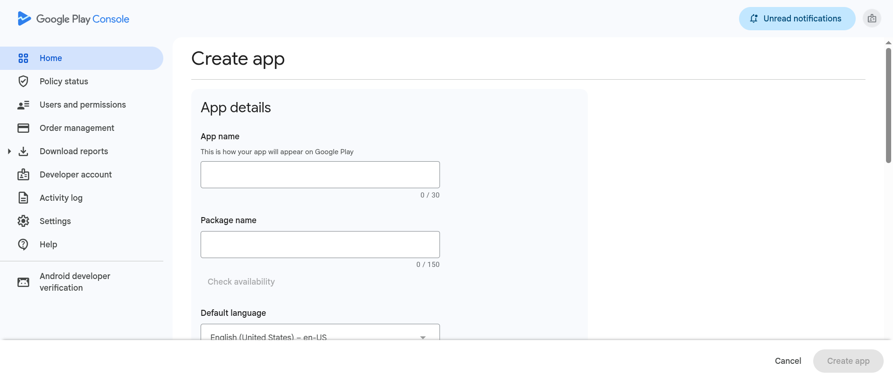
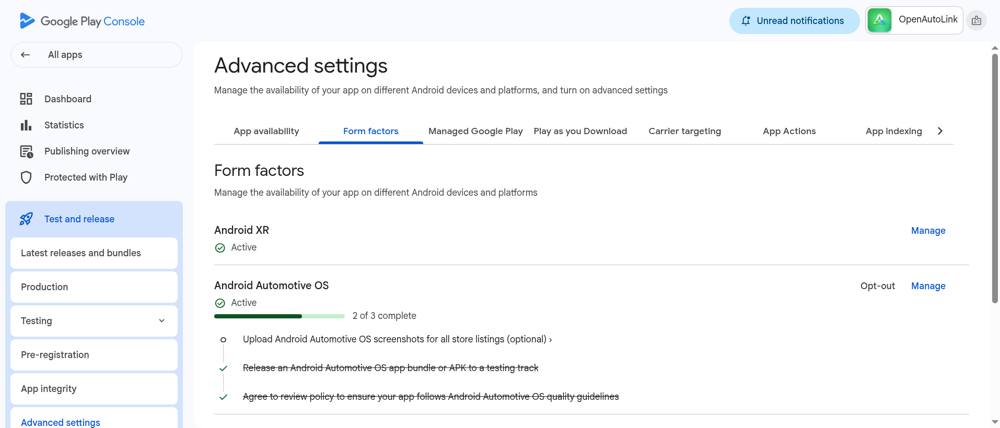
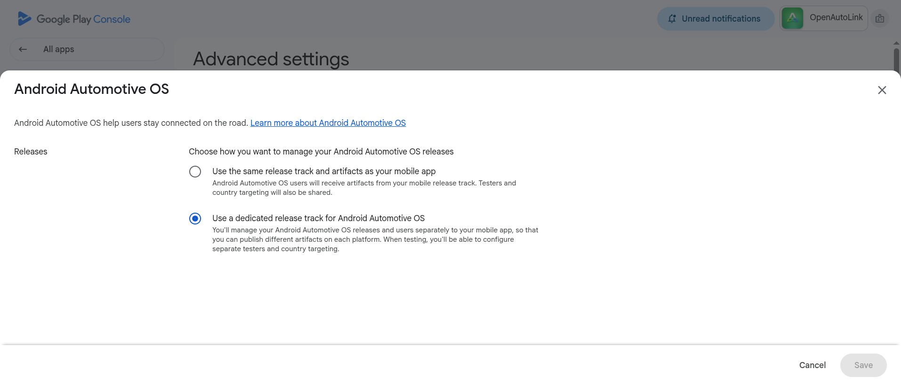
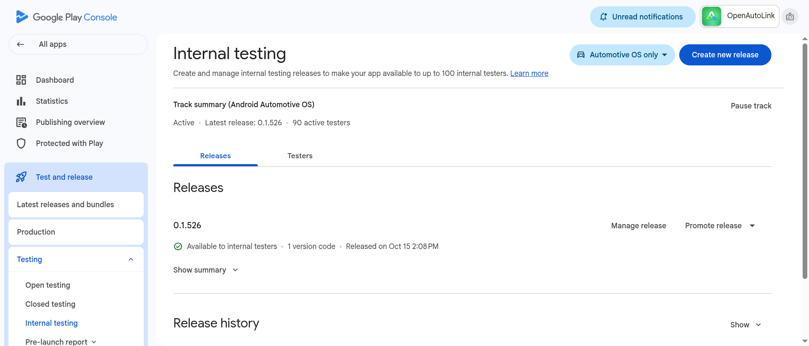
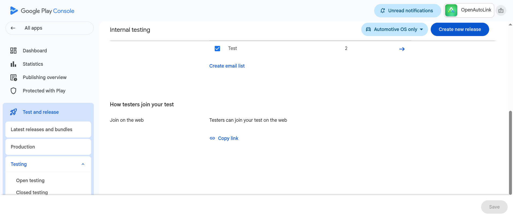

# Install OAL on your car through Internal Test

For a locked GM Android Automotive OS head unit, install OpenAutoLink through **your own Google Play Console app and its dedicated Android Automotive OS Internal Test**. A GitHub car APK cannot be sideloaded onto these locked head units.

You will build a personal signed `.aab`, upload it to your app, enroll the Google account used in the car as a tester, and tell Google Play to install it **on the car**. Do this while parked. This guide does not change the car's operating system.

**Create your AAB first:** follow [Create your AAB](build-aab.md#create-your-aab)—personalize a supported precompiled release—including the current development/download notice. No source editing is needed. For CarPlay, the build also needs your own [authorized authentication pair](carplay-private-mfi-assets.md); building or installing OAL alone does not provide it.

## Before you begin

Have these ready:

- Your signed car `.aab` and its recorded application ID and version code.
- A secure backup of your builder identity and upload key.
- A browser on your computer or phone for Play Console and the tester link.
- The **exact Google account email used in the vehicle's Play Store**. Check the account in the car rather than assuming it is the one in your phone or desktop browser.
- An internet connection for **the car itself**, for example home Wi-Fi or your phone's hotspot. A local car hotspot without upstream internet is not enough. [An OnStar data plan is not required](../README.md#car-internet-no-onstar-data-plan-required).

The developer-account email and car tester email may be different. For enrollment and installation, the browser's Google identity must match the car's tester identity.

## 1. Register your Play Console developer account

If you already have a verified developer account, sign in and check for outstanding account requirements. Otherwise:

1. Open **[Play Console registration](https://play.google.com/apps/publish/signup)** using the Google account that will own your app. You must be at least 18.[1]
2. Select the account type that truthfully fits you, such as **Personal** for an individual. Do not choose an organization simply to avoid verification.[1]
3. Review the Developer Distribution Agreement and accept it only if you agree.[1]
4. Pay Google's **US$25 one-time registration fee** using an accepted payment method. This is paid to Google, not OAL; accepted cards vary by location.[1]
5. Supply your real identity and contact details, and complete the identity, email, phone, payment-profile, or other verification requests shown for your account. Google may ask for government ID and a card in your legal name. Do not skip outstanding account-verification tasks.[1]
6. **New personal accounts also need access to an Android device for device verification using Google's Play Console mobile app.** Follow the device-verification task in your Console account.[1]

> [!IMPORTANT]
> **iPhone owners:** you can use CarPlay with OAL, but an iPhone does not satisfy Google's Android-device verification requirement. Arrange access to a qualifying Android device and check Google's current instructions before paying. Do not assume the car's head unit can complete this mobile-app verification.[1]

Account verification is a Google requirement, not something the desktop builder can perform or bypass. Continue once Console lets your account create and manage the Internal Test.

## 2. Create your free Play Console app

1. In Play Console, select **Home → Create app**.[6]
2. Choose your default language and an app name, for example **OpenAutoLink Personal**. The name is a label; your generated package ID is the permanent identity.[6]
3. Select **App**, not Game, and **Free**.[6]
4. Provide a contact email you monitor if requested.[6]
5. Read the declarations shown, including Developer Program Policies, US export laws, and Play App Signing terms. **You must review and answer truthfully**; this guide does not authorize a blanket acceptance or supply legal declarations for you.[6]
6. Select **Create app**.[6]

If the creation form requests a package name/application ID, copy the exact value from your builder. Some Console flows establish it from the first AAB instead. In either case, check that Console and the uploaded AAB show the same ID; after the artifact is uploaded, that package name is fixed.[4]

### Complete only the setup Console requires for this Internal Test

Google explicitly permits an Internal Test before all app setup is complete. Do not assume you must finish a full store listing or a Data safety questionnaire first; apps active only on Internal Test are exempt from inclusion in the Data safety section.[4]

If Console blocks your next step with a required task, read and complete that task accurately. This can include account verification or declarations appropriate to your app. Use the [OAL privacy policy](privacy-policy.md) to understand OAL's behavior, but review your own build and configuration rather than copying answers blindly. If screenshots or listing material are requested, supply real, current app captures and accurate descriptions—not invented Console or app images.

A new Internal Test can show a temporary app name/listing while Google processes it. That alone does not mean you uploaded the wrong package.[4]

## 3. Enable the dedicated Android Automotive OS track

**This selector matters: OAL runs on Android Automotive OS in the car. Do not leave the release form factor set to mobile, and do not select Android Auto instead.**

In your new app:

1. Open **Test and release → Advanced settings**.[2]
2. Select **Form factors**.[2]
3. Click **+ Add form factor → Android Automotive OS**, if it is not already listed.[2]
4. Next to **Android Automotive OS**, click **Manage**.[2]
5. Under **Releases**, select **Use a dedicated release track for Android Automotive OS**.[2]
6. Click **Save**. Google notes that this dedicated-track choice cannot subsequently be changed.[2]

**Track setup is not the separate car-quality review opt-in.** If the page offers an additional review-policy or distribution opt-in, it is not a required step for this Internal Test. Google's car-distribution documentation lists **Internal testing → Form factor review: None**. Save the dedicated-track setting; do not turn an optional review opt-in into an installation prerequisite.[2][3]

Now open **Test and release → Testing → Internal testing**. In the page's form-factor selector choose **Android Automotive OS** (it may be labeled **Android Automotive OS only**). Before uploading, confirm both pieces of context: **Android Automotive OS** and **Internal testing**.[2][4]

## 4. Create and roll out the Internal Test release

1. On that **Android Automotive OS → Internal testing** page, select **Create new release**.[5]
2. For your first release, follow the **Play App Signing** setup. For a new app, use Google's generated app-signing key option/default after reviewing the terms.[5][7]
3. In **App bundles**, choose **Upload** and select the signed car `.aab` from the desktop builder's successful result. Wait for processing to finish.[5]
4. Check that the package ID and version code shown are the ones you recorded. Do not substitute the companion APK, desktop executable, backup archive, or an unfinished build output.
5. Enter a release name, such as **Personal internal test 1**, and truthful release notes, such as **Initial personal OAL car build**. These are examples, not required names. Use the release-note language field or tags Console supplies.[5]
6. Select **Save** or **Save as draft**, then **Next** or the review action shown. Saving a draft alone does **not** make the app available.[5]
7. Review the summary. Resolve blocking errors and read any warnings. Confirm the form factor is still **Android Automotive OS** and the destination is **Internal testing**.
8. Select **Start rollout to internal testing** (or the equivalent confirmation shown) and confirm. Return to the track's **Releases** tab and verify the release is available to testers, not merely saved as a draft. If Console reports pending processing or another required action, follow that status before expecting installation.[5]

### Two different Android signing keys

- **Upload key:** generated and saved by your desktop builder; signs the AAB you submit so Google can recognize your upload identity.
- **App-signing key:** managed by Google with Play App Signing; signs the APKs Play delivers to the car.[7]

They are not the CarPlay `.pk8`/`.p7b` pair. Keep the same accepted upload identity for updates and protect its backup. A newly generated key is not interchangeable with the one registered for an existing app.[7]

## 5. Add and select your tester list

Stay on the **dedicated Android Automotive OS Internal testing** track:

1. Open the **Testers** tab.[4]
2. Select **Create email list**, give it a recognizable name such as **My car**, and enter the exact Google account email used in the vehicle's Play Store.[4]
3. Save the email entries and create the list using **Save changes / Create** as shown.[4]
4. Back in the **Testers** table, **select the checkbox for that list**. Creating a list without selecting it does not enable it for this track.[4]
5. Supply a feedback email or URL if requested, then select **Save changes** for the track.[4]
6. Reopen the tab and confirm the intended list is still selected and contains the car account.

Adding an email is only permission to join. The tester still needs to accept the invitation in the next step.[4]

## 6. Copy “Join on web” and become a tester

1. In the track's **Testers** tab, find **How testers join your test → Join on web** and copy the shareable opt-in link provided by Console. **Copy the complete URL exactly**; do not construct one from the app name or package ID.[4]
2. Open that copied link in a browser on your computer or phone.
3. Check the Google profile/account menu: it must be signed in as the **same Google account used by the vehicle's Play Store and saved in your tester list**. Switch accounts if necessary.
4. Select **Become a tester** or the join/accept action shown, then confirm the page says you are a tester.[4]
5. Follow the page's **download it on Google Play** / Google Play link. Keep the same Google identity selected there too.[4]

The opt-in link is not the same thing as the store listing URL. Save the real Console link privately for later. Do not depend on a Play Store search to discover an Internal Test app; use the invitation and its Play link.[4]

## 7. Install on the car—not just on the phone

1. Turn on the parked car's infotainment system and connect **the car** to working internet. Open its Play Store and confirm the tester Google account is signed in.
2. In your phone/computer browser, use the Google Play link reached after joining the test.
3. On that web listing, choose **Install** or **Install on more devices**, depending on the page shown.
4. Open the device picker and select **your car** by its displayed device name. Check that it is eligible and selectable. A visible **Install** button alone is not proof of car eligibility; it may refer to a different device.[8]
5. Confirm installation for the car. If Google requests account authentication, complete it directly with Google.
6. Keep the car online and allow Play to deliver the app. Confirm **OpenAutoLink appears in the car's app launcher**, then open it. A web confirmation or queued request is not the same as installation on the head unit.

If the car is missing or marked incompatible in the picker, stop and use the eligibility checks below. Installing onto a phone does not install OAL onto the vehicle.

## 8. Finish phone and permission setup

Once the app is installed:

1. While parked, open the vehicle's **Settings → Apps → OpenAutoLink → Permissions** and grant supported permissions needed for the features you use, including microphone and available car-data permissions. Then **return to OpenAutoLink**.
2. For wireless Android Auto, install the matching companion APK from [GitHub Releases](https://github.com/mossyhub/openautolink/releases/latest) on the Android phone and follow [Wireless WPP setup](wireless-wpp.md), including the companion's scan-and-send setup.
3. USB Android Auto needs no companion. Follow the [USB instructions](../README.md#android-auto-setup).
4. USB CarPlay needs no iPhone companion. Use a data-capable cable, leave the iPhone unpaired from the vehicle's Bluetooth, and follow [CarPlay setup](../README.md#carplay-setup), including USB and VPN consent. Your build must have a valid, authorized CarPlay authentication identity.

`CAR_ENERGY` and `CAR_SPEED` are dangerous permissions on inspected Android 14 / GM firmware; `CAR_INFO` is normal and normally install-granted, not a runtime dialog permission. Some vehicle permissions are privileged/signature-only and cannot be granted to a normal Play app. Available properties vary by firmware and vehicle.

OAL rechecks newly granted vehicle permissions when you return to it, but surviving-process refresh still needs vehicle validation. If EV values remain absent, inspect **Diagnostics → VHAL Property Status**; force-stop and reopen is a fallback. Installation and permission grants alone do not prove support for every vehicle-data or cluster feature. See [Compatibility](compatibility.md).

## Updating later

1. Open the desktop tool using the **same managed folder and identity**. Check the latest stable release and create a new AAB using its supported personalization template. A missing/unsupported template is not permission to relabel an older build as the new release.
2. Confirm the application ID is unchanged, the accepted upload key is reused, and the version code is higher than every previously uploaded code.
3. Make a current encrypted identity backup.
4. Open the **same Play Console app → dedicated Android Automotive OS → Internal testing**. Create a new release, upload the new `.aab`, add accurate release notes, review, and roll out as in step 4.[5]
5. Keep the car signed in with the tester account and give it internet access. Use **Update** in its Play Store or allow automatic updates, then check the installed OAL version.

Existing enrolled testers normally keep their membership; there is no need to create another Play app or another package ID. Building an AAB or updating the desktop builder does not itself update the car.

## Troubleshooting

### Membership: “not available” or cannot join

- Check the actual Google account selected in the invitation browser, Play web listing, and car Play Store.
- In **Android Automotive OS → Internal testing → Testers**, verify the exact email is in a list, the list is selected, and changes were saved.
- Open the exact **Join on web** URL copied from that track, and confirm **Become a tester** completed. Do not use a guessed URL or only the store listing.[4]

### Rollout: there is no installable release

- Confirm you uploaded the signed **car AAB** to the correct app and the dedicated **Android Automotive OS** Internal Test.
- Confirm you completed rollout, not just **Save as draft**. Check the release's actual status, processing, and outstanding errors in Console.[5]
- If **Create new release** is disabled, inspect the specific outstanding setup task or unfinished release shown; do not assume every dashboard task must be completed.[4][5]

### Eligibility: the car is absent or incompatible

- Open the car's Play Store under the tester identity while the car is online, then retry the web device picker under that same identity.
- Confirm the dedicated **Android Automotive OS** setting and selector, not mobile or Android Auto.
- Inspect the uploaded bundle's supported devices/compatibility in Console and compare the exact vehicle and software version. A selectable phone or an **Install** button does not prove the car is eligible.
- Do not try to solve vehicle incompatibility by changing the package ID or signing key. Google Play eligibility and OEM support are separate from tester membership.

### Propagation: settings are correct but the link/update has not arrived

Test links and changes can take several hours to become available. New apps can temporarily show placeholder naming supplied by Google. Recheck the copied link and car Play Store after processing has had time to complete; no fixed delivery time is guaranteed.[4]

Keep the car online. A remote-install request can remain queued while the infotainment system is asleep or disconnected. If the delay persists, check the exact Console status and Google Play account/device state rather than repeatedly recreating the app.

### Signing or version rejection

Use the original package ID and accepted upload key, and a version code greater than all previous uploads. Restore the correct builder identity rather than generating a replacement. If the upload key is lost, follow Google's upload-key recovery process; a different key does not automatically update the same app.[7]

### Installed but vehicle features are missing

Check car permissions and [Compatibility](compatibility.md). Non-GM AAOS vehicles may have different Play delivery, networking, audio policies, vehicle APIs, and display integration; a GM result is not proof of support elsewhere.

## About the screenshots

These are genuine captures of the blank creation form and an existing OAL app’s Console pages, not mockups. Your app name, version, and tester count will differ. Use your own package name and your own Join-on-web link. The images demonstrate navigation only; account registration, upload, rollout, enrollment, and installation still require completing the steps above. No tester emails are shown.

## Sources

[1] https://support.google.com/googleplay/android-developer/answer/6112435
[2] https://support.google.com/googleplay/android-developer/answer/13295490
[3] https://developer.android.com/training/cars/distribute
[4] https://support.google.com/googleplay/android-developer/answer/9845334
[5] https://support.google.com/googleplay/android-developer/answer/9859348
[6] https://support.google.com/googleplay/android-developer/answer/9859152
[7] https://support.google.com/googleplay/android-developer/answer/9842756
[8] https://support.google.com/googleplay/answer/14274288?hl=en — Install apps on other devices
