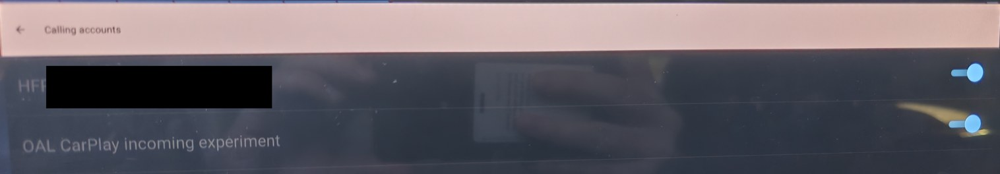
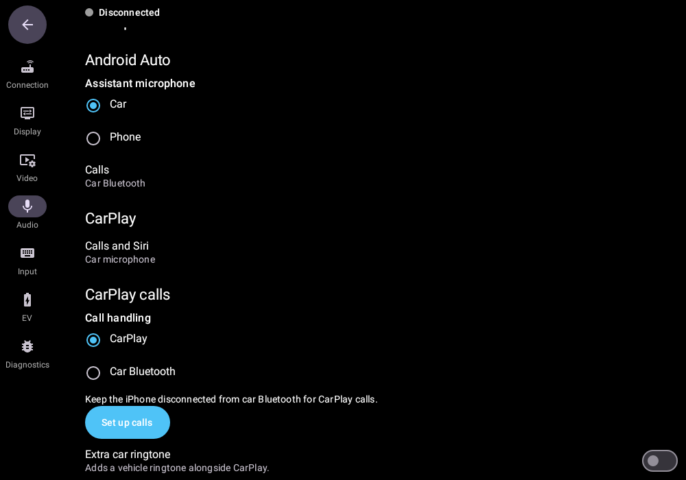

# Phone calls and microphones

## Choose the call path

- **Android Auto, USB or wireless:** pair the Android phone with the car and keep Bluetooth **Phone calls ON**. Calls use native Bluetooth hands-free audio and the car microphone. USB projection does not replace this call path.
- **CarPlay, recommended USB:** leave the iPhone **unpaired from car Bluetooth**. Calls and button-initiated Siri use the car microphone through CarPlay. Complete the one-time setup below for native call display and steering-wheel controls on supported vehicles.

Select **OpenAutoLink** in vehicle **Audio** for projected music/navigation. Media-source selection does not change the call path. See [phone media playback](../README.md#play-phone-media-from-vehicle-audio).

## Android Auto — USB and wireless

1. Follow [USB setup](../README.md#usb) or [wireless WPP setup](wireless-wpp.md). USB needs no companion; wireless needs the matching Android companion.
2. Pair the phone with the car and keep Bluetooth **Phone calls ON**. Wireless also needs this profile for startup. Disable Bluetooth **Media audio** if it competes with projected music.
3. Open **Settings → Audio → Microphone → Android Auto**. Leave **Assistant microphone → Car** for the car microphone, or choose **Phone** for assistant input from the phone. This choice does not affect calls or CarPlay.

Audio choices save automatically. The assistant choice applies to the next microphone stream; **Android Auto · Volume offsets** (**Media**, **Navigation**, **Assistant / Speech**) apply to the next Android Auto connection. Their default is 0, and they do not adjust CarPlay.

## CarPlay — recommended unpaired USB

1. Install OAL with your own [authorized authentication files](carplay-private-mfi-assets.md), select **Settings → Connection → CarPlay → CarPlay connection → USB**, and tap **Save changes**. If already connected, unplug and reconnect to apply connection changes.
2. **Unpair the iPhone from the car and leave Bluetooth disconnected.** Connect a data-capable cable. [Approve both GM USB prompts each time](../README.md#gm-usb-prompts--android-auto-and-carplay), OAL’s separate local VPN consent when requested, and any iPhone **Trust** prompt. USB needs no car Wi-Fi setup.
3. Select **OpenAutoLink** in vehicle **Audio** for music/navigation.
4. In **Settings → Audio → CarPlay calls**, leave **Call handling → CarPlay** (Recommended) and **Extra car ringtone → Off**.
5. Tap **Set up calls**, allow Android’s phone permission, enable **OpenAutoLink** in **Calling accounts**, and return to OAL. **Setup → Ready** updates automatically. If permission was already granted, the action may read **Continue to calling accounts** instead.
6. Allow microphone access for calls and Siri. Under **Audio → Microphone → CarPlay**, use **Enable microphone** if shown. If OAL asks to reconnect afterward, reconnect USB when not in a call.

Call setup is needed once, not on every reconnect. An approved older OAL account remains usable. Your handler and ringtone choices are saved automatically; there is no Save, Inspect, Arm or Apply step for normal calls/Siri. A handler change during a call applies to the next call and leaves the current call running.

*Turn on the OAL account, then return to OAL. Its current name is OpenAutoLink.*

### Alternative — Car Bluetooth calls

> [!WARNING]
> **Bluetooth can cause repeated media pauses, even with Media audio off.** Use unpaired USB CarPlay for the recommended setup.

If you need to keep the iPhone paired:

1. In **Settings → Audio → CarPlay calls**, select **Call handling → Car Bluetooth**.
2. Pair the iPhone with the vehicle and keep **Phone calls ON / Media audio OFF**.
3. Open **Settings → Connection → CarPlay → Android Bluetooth settings** and disconnect/reconnect the pairing after changing profiles. Return to OAL and keep **OpenAutoLink** selected in vehicle Audio for CarPlay music/navigation.

In this mode, the car’s Bluetooth system handles calls; OAL does not add its own native-call presentation or controls. OAL calling-account approval is not needed. CarPlay Siri still uses the car microphone. The handler selector does not change Bluetooth profiles or the iPhone’s audio destination for you.

GM may restore Media audio after a wake; recheck it if playback changes. Media OFF and reconnecting do not reliably prevent pauses. Do not use Bluetooth and OAL as simultaneous native call providers, or expect automatic call-provider handover when another phone connects.

## Audio settings

**Extra car ringtone** is Off by default so CarPlay supplies the ring. Turn it On only if you need an additional vehicle alert. **Android call settings** and **Android sound settings** open optional system pages; they are not required after setup is Ready.

## Keep the projected screen visible on GM

1. Open the vehicle’s native **Phone → Settings**.
2. Turn **Active Call OFF** (“Show active call view when answering call”).
3. Turn **Privacy ON** (“Only show call alerts in cluster”).

These affect the call display, not Bluetooth or OAL permission. Leave Android Auto’s Bluetooth Phone calls enabled.

## Check calls and Siri while parked

1. Receive a call and check Answer, End and a separate Reject attempt.
2. Ask the caller to confirm they hear you from the driver’s seat, and confirm their voice comes through the car speakers.
3. Try button-initiated Siri, then check music and navigation after the call. “Hey Siri” wake detection is handled separately by the iPhone.
4. Check again after a later reconnect.

### Limits and help

- The cluster may show **Unknown** or a number while CarPlay shows the contact name. Call approval does not change the car’s contact lookup.
- OAL’s native CarPlay integration supports single incoming calls, not outgoing, held or conference-call integration. Native controls vary by vehicle.
- If **Call setup unavailable** appears, disconnect iPhone Bluetooth for CarPlay calls or select **Car Bluetooth**. Follow any permission/account message shown in Audio.
- For silent calls, check microphone permission, the selected handler and the iPhone’s call-audio destination. Bluetooth calls need **Phone calls ON**.
- Returning from FM? Select OpenAutoLink in vehicle Audio and press normal **Play** if needed; there is no separate Resume audio button.

See [troubleshooting](troubleshooting.md) for problems. [Advanced microphone diagnostics](microphone-diagnostic.md) are optional and are not needed for normal setup. Wireless CarPlay remains in development; use USB.
