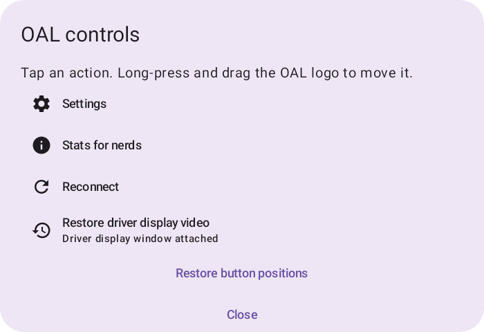

# Driver-display settings

Open **Settings → Secondary Displays**. **Driver-display video** applies to both Android Auto and CarPlay; it does not change the main infotainment display.

**Driver-display maps are disabled by default.** On GM vehicles, you must choose either driver-display maps or native navigation icons and HUD guidance—not both. GM's privileged navigation/display restrictions prevent OAL from keeping both active together; this trade-off is why the feature ships turned off.

## Enable it

1. Turn on **Driver-display video**.
2. Select **Save changes**.
3. **After first enabling it, manually restart the GM head unit.** While parked, hold the steering-wheel **End Call** button for about **30 seconds**, then wait for the head unit to restart itself.

Wireless settings reconnect automatically when safe. **USB: unplug and reconnect after saving to apply.** The current USB session keeps its admitted settings until physical reconnect.

To return to native navigation icons/HUD, turn **Driver-display video** off and select **Save changes**. Native guidance requires an active route supplying usable navigation instructions. Saved Android Auto roles and custom geometry are preserved; opening Settings or editing a draft does not change the running session.

## Make it suit your display

**Your phone controls the map and turn-card video on the driver display.** OAL displays the video supplied by Android Auto or CarPlay and your navigation app, with layout customization options. The layout and information shown can therefore change with phone-app updates. The optional **Drive Card** below is drawn by OAL separately.

### Optional Drive Card · Android Auto and CarPlay

With **Driver-display video** on, enable **Drive Card** for the selected display, then select **Save changes**. It is off by default and applies to both Android Auto and CarPlay. Wireless reconnects automatically when safe; **USB: unplug and reconnect after saving**.

The GM-inspired right-hand panel adds available drive-efficiency information, genuine completed efficiency-history windows, qualified battery power and battery on arrival when fresh navigation and vehicle data support it. **NOW** is current qualified driving efficiency; **RECENT** is measured recent history. Battery **Use** and **Inflow** describe net battery power, not a calibrated motor gauge; inflow alone does not mean the car is plugged in and charging. Unsupported or stale values are omitted.

An **≈** marks a local approximate arrival estimate, separate from Apple's prediction. Before driving history is ready, fresh current energy and dashboard remaining range can support that estimate using qualified capacity; completed measured history takes priority once ready. An Android Auto-supplied forecast remains separately sourced and takes priority when qualified. No history is fabricated while learning, and changing destination retires the old arrival association without erasing vehicle efficiency history. Turning the card off preserves the phone-video-only view.

**Units are automatic.** The card honors the existing explicit metric/imperial preference. In Automatic, it follows current vehicle-reported distance units when available and falls back to locale otherwise. Efficiency values and graph labels convert together between km/kWh and mi/kWh; power remains kW. Unit changes do not reset the internal history or renegotiate the phone.

Choose **Adjust Drive Card** to move the card or resize it by dragging a corner. **Slant** adjusts the angled edge; **Reset** stages the default position. Keep the vehicle gauges and warning areas visible. The card's position uses the full admitted drawable, independently of the phone's Directions area.

The adjustable box positions the card's content. Its black backing continues toward the bottom and right edges inside the existing output window and clip, separately from that content box. Top-left lighting fades to opaque pure black before those edges; saved content position, size and slant are not reset by this correction.

With the selected driver-display output already active, **Show on driver display · 30s** previews the draft on that existing output. Editing does not extend the deadline. **Stop preview**, **Done**, Back, or leaving the editor ends the preview and restores the session layout; no new window, surface or phone session is acquired. **Done does not save.** Return to Settings and select **Save changes**; for USB, unplug and reconnect after saving.

This is an OAL overlay, not a new OEM gauge or windshield-HUD publisher. It follows the admitted video window and does not change the GM choice between video and native navigation/HUD guidance.

### Android Auto

With video on, choose the phone-facing role:

- **Cluster:** a more compact navigation layout.
- **Auxiliary:** Google Maps adds destination and speed information. A useful starting point for larger driver displays.

**Android Auto density does not affect CarPlay.** The default is **149 DPI** for Android Auto secondary displays, with physical display metadata preserved. Existing installations move to the new density once; subsequent density edits or choosing Automatic persist normally. The **Custom Android Auto density** slider covers **80–320 DPI** for the selected driver display only; it does not change the main feed. Lower DPI requests smaller phone-rendered text and cards, not a change to the map's camera zoom. Select **Save changes** and reconnect to apply (wireless reconnects automatically when safe; unplug/reconnect USB). Turn the control off to restore **Automatic · 149 DPI**.

#### Higher-resolution Android Auto video

Android Auto supplies the driver-display video in one of a few fixed sizes. OAL shows the centred band that matches the display's shape and stretches it to fill the display, so the default **720p · H.264** can look soft on a large panel.

Under **Android Auto video resolution**, choose **1080p**, **1440p** or **4K** (all H.265) for the selected display. The multiplier beside each choice, such as **(1.5x)**, is how far that size is stretched to fill this display. Closer to **1.0x** is sharper, but asks more of the phone and the car's video decoder.

- **Text and cards keep their size.** OAL scales the density it reports to the phone with the video size, so the density control above means the same at every size.
- **Unsupported sizes step down.** If the car reports no H.265 decoder for the chosen size, OAL advertises the next smaller one.
- **GM-hosted displays stay at 720p.** A display on GM's qualified cluster route keeps its 720p H.264 stream and does not show this choice.

Select **Save changes** and reconnect to apply; for USB, unplug and reconnect after saving. If the driver display stutters or stays blank, choose a smaller size. A reported decoder is not proof that a particular phone and vehicle will accept a size.

### Apple CarPlay

Choose **CarPlay display view** for the selected driver display:

- **Apple's cluster view** (default): requests Apple's cluster content. iOS and the navigation app choose its layout; a turn card, following camera or 3D view is not guaranteed.
- **Map only**: the map without the turn card.
- **Turn card only**: the next-turn card without the map.

Select **Save changes** and reconnect to apply. For USB, unplug and reconnect after saving. Each display keeps its own choice; existing records without a choice use Apple's cluster view. OAL advertises the supported content choices and requests the saved choice after the encrypted event channel and cluster stream are ready. A written request is not an acknowledgment that Apple changed its rendering. iOS and the navigation app control the supplied content, including whether there is a card when no route is active. This does not change Android Auto's Cluster/Auxiliary role, density or saved Directions area.

Thanks to [Mark Samberg (@mjsamberg)](https://github.com/mjsamberg) for the CarPlay view selection contribution. He reports testing it on an Equinox EV; this is not a guarantee of identical layout on every vehicle, iPhone or navigation app.

#### Higher-resolution CarPlay video

OAL qualifies the driver-display video size against the actual display and Android decoder capabilities, retaining a lower-resolution H.264 fallback. Resolution, frame rate and codec support are separate from physical phone acceptance.

CarPlay uses **Automatic (H.264 + qualified HEVC)** by default for both the main and driver displays. OAL offers HEVC only when the exact decoder receipts and combined-display limits permit it, retaining H.264 fallback. The old separate driver-display experiment switch no longer vetoes Automatic. Saved **H.264** selections remain a working opt-out. After **Save changes**, reconnect; for USB, unplug and reconnect. If video fails on a particular phone/display, choose H.264 and reconnect.

See the [Android Auto and CarPlay photos](../README.md#driver-display-maps--oal-01575).

## Directions area

**We strongly recommend trying the Directions area editor.** The default may not fit your car’s screen shape or layout. The green box sets where the navigation app can draw its directions card. One **Directions area** editor serves Android Auto and CarPlay. Video still fills the whole available drawable; the editor never resizes the full video. The editor header identifies the protocol used for the preview. A connection already selected takes precedence; otherwise it uses the configured next connection, which a later USB choice can override.

1. Open **Directions area**.
2. Drag the green box to move it; drag its corner handles to resize it.
3. To preview physically, disconnect projection, then optionally select **Show on driver display · 30s**. Stop the preview or let it expire; edits do not restart its timer. If preview is unavailable, the editor shows the required next action.
4. Select **Done** to stop the preview and return the draft to Settings.
5. Tap **Save changes**. Wireless reconnects automatically when safe. **USB: unplug and reconnect to apply.**

### Check the result after saving

- **Apple Maps on CarPlay:** Start turn-by-turn navigation. With guidance still running, tap the app-grid button to open **CarPlay Home** on the main screen. When Apple Maps leaves the foreground there, its driver-display view switches to show a directions card. Check where the card appears and adjust the green box if it is clipped or in the wrong spot.
- **Google Maps on Android Auto:** Start turn-by-turn navigation to any destination. Google Maps already displays the directions card on the driver display during active guidance, so there is no need to leave Maps on the main screen.

**Done does not save.** Opening the editor, showing its outline or selecting Done without an edit preserves existing saved areas. An actual edit or **Restore default** stages a shared change for both Android Auto and CarPlay; it takes effect after Save and the required reconnect.

**Restore default** selects Automatic without changing the full video window. The preview follows the displayed protocol; Android Auto and CarPlay can use different Automatic areas. Automatic is an estimate, not detection of the GM overlay. The existing calibrated Android Auto default on the supported **2000×810** direct drawable remains **(192, 71)–(1788, 660)**. Its earlier one-time migration did not change CarPlay geometry, display enablement or phone-facing role; opening this editor does not repeat that migration. See [direct-window details](direct-cluster-window.md).

## Returning to the maps page

Driver-display video may occasionally be black, including after changing pages. Select the maps page on the driver display, tap the **floating OAL logo/menu button** on the main infotainment screen and choose **Restore driver display video**. This retries the current video window without using the full **Reconnect** action. The floating button may be in a different position if you have moved it.

If the menu says **Reconnect required to enable driver display**, use the existing **Reconnect** action while the maps page is selected. If restoration fails, upload logs with the action and approximate time before reconnecting or restarting OAL. See [troubleshooting](troubleshooting.md#driver-display-video-stays-black-after-changing-pages).
