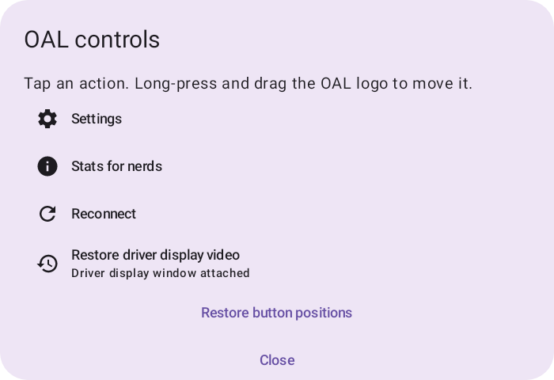

# Driver-display settings

Open **Settings → Secondary Displays**. **Driver-display video** applies to both Android Auto and CarPlay; it does not change the main infotainment display.

**Driver-display maps are disabled by default.** On GM vehicles, you must choose either driver-display maps or native navigation icons and HUD guidance—not both. GM's privileged navigation/display restrictions prevent OAL from keeping both active together; this trade-off is why the feature ships turned off.

## Enable it

1. Turn on **Driver-display video**.
2. Select **Save changes**.
3. **After first enabling it, manually restart the GM head unit.** While parked, hold the steering-wheel **End Call** button for about **30 seconds**, then wait for the head unit to restart itself.

Wireless settings reconnect automatically when safe. **USB: unplug and reconnect after saving to apply.** The current USB session keeps its admitted settings until physical reconnect.

To return to native navigation icons/HUD, turn **Driver-display video** off and select **Save changes**. Native guidance requires an active route supplying usable navigation instructions. Saved Android Auto roles and custom geometry are preserved; opening Settings or editing a draft does not change the running session.

## Make it suit your display

**Your phone controls what appears on the driver display.** OAL does not generate that view; it displays the video supplied by Android Auto or CarPlay and your navigation app, with some layout customization options. The layout and information shown can therefore change as Android Auto, iOS/CarPlay and your navigation apps are updated.

### Android Auto

With video on, choose the phone-facing role:

- **Cluster:** a more compact navigation layout.
- **Auxiliary:** Google Maps adds destination and speed information. A useful starting point for larger driver displays.

**Android Auto density does not affect CarPlay.** The default is **149 DPI** for Android Auto secondary displays, with physical display metadata preserved. Existing installations move to the new density once; subsequent density edits or choosing Automatic persist normally. The **Custom Android Auto density** slider covers **80–320 DPI** for the selected driver display only; it does not change the main feed. Lower DPI requests smaller phone-rendered text and cards, not a change to the map's camera zoom. Select **Save changes** and reconnect to apply (wireless reconnects automatically when safe; unplug/reconnect USB). Turn the control off to restore **Automatic · 149 DPI**.

### Apple CarPlay

There is no equivalent Cluster/Auxiliary selector in OAL.

See the [Android Auto and CarPlay photos](../README.md#driver-display-maps--oal-01575).

## Directions area

**Usually no adjustment is needed. Edit only if directions or other non-map content are hidden or cut off.** This area applies to Android Auto and CarPlay. Video still fills the whole available drawable; the editor never resizes the full video.

1. Open **Directions area**.
2. Drag the green box to move it; drag its corner handles to resize it.
3. Optionally select **Show on driver display · 30s**. Stop the preview or let it expire; edits do not restart its timer. If preview is unavailable, the editor shows the required next action.
4. Select **Done** to stop the preview and return the draft to Settings.
5. Tap **Save changes**. Wireless reconnects automatically when safe. **USB: unplug and reconnect to apply.**

**Done does not save.** **Restore default** restores the inner area without changing the full video window or unrelated saved geometry. The calibrated Android Auto default on the supported **2000×810** direct drawable is the important-content rectangle **(192, 71)–(1788, 660)**, while the video still fills the whole drawable. The update moves existing Android Auto directions areas to that default once; later user adjustments persist. Other drawable sizes retain their existing safe fallback. The migration does not change CarPlay geometry, display enablement, or phone-facing role. See [direct-window details](direct-cluster-window.md).

## Returning to the maps page

Driver-display video may occasionally be black, including after changing pages. Select the maps page on the driver display, tap the **floating OAL logo/menu button** on the main infotainment screen and choose **Restore driver display video**. This retries the current video window without using the full **Reconnect** action. The floating button may be in a different position if you have moved it.

If the menu says **Reconnect required to enable driver display**, use the existing **Reconnect** action while the maps page is selected. If restoration fails, upload logs with the action and approximate time before reconnecting or restarting OAL. See [troubleshooting](troubleshooting.md#driver-display-video-stays-black-after-changing-pages).
